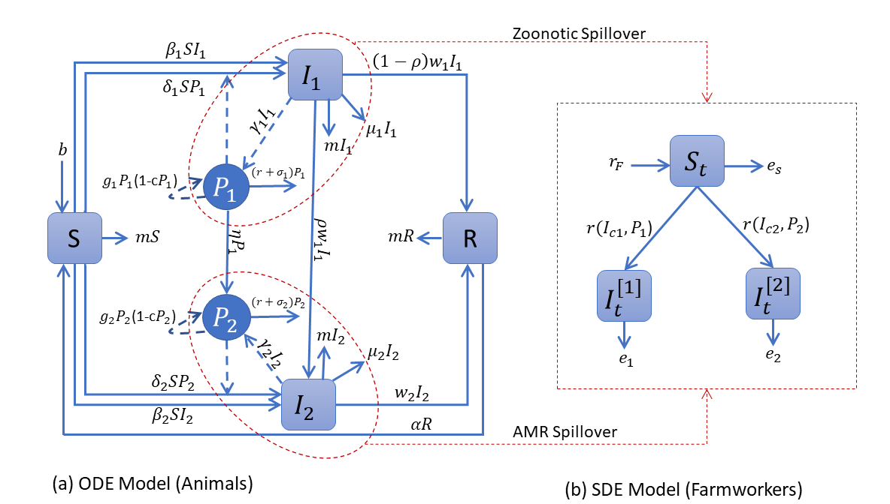

# Biosecurity Compliance and Antimicrobial Resistance: A One Health Modeling Framework

**Infectious disease modeling · ODEs and stochastic simulation · Monte Carlo analysis · Biosecurity interventions**

This repository accompanies our peer-reviewed study of how biosecurity practices influence the transmission of drug-susceptible and drug-resistant *Salmonella* in a dairy-farm setting. Our One Health framework connects **cattle**, the **farm environment**, and **farmworkers** to investigate how changes in contact, environmental exposure, and pathogen removal may affect infection risk.

**Published article:** Arjmand, A., Bani-Yaghoub, M., Corkran, K., Pandit, P. S., & Aly, S. S. (2025). *Assessing the impact of biosecurity compliance on farmworker and livestock health within a One Health modeling framework.* **One Health, 20**, 101023. [https://doi.org/10.1016/j.onehlt.2025.101023](https://doi.org/10.1016/j.onehlt.2025.101023)

## Research questions

- How do direct cattle-to-cattle contacts and indirect environmental exposure contribute to the persistence of antimicrobial-resistant pathogens?
- How can varying levels of biosecurity compliance change the transmission dynamics of susceptible and resistant strains?
- What can a hybrid deterministic–stochastic modeling framework tell us about infection risks across livestock and farmworkers?

## Mathematical modeling approach

### Cattle–environment dynamics: deterministic model

The cattle and environmental subsystem uses a **six-compartment, two-strain ODE model**:

| State | Interpretation |
|---|---|
| `S` | Susceptible cattle |
| `I1` | Cattle infected with the drug-susceptible strain |
| `I2` | Cattle infected with the drug-resistant strain |
| `R` | Recovered cattle |
| `P1` | Environmental load of the drug-susceptible strain |
| `P2` | Environmental load of the drug-resistant strain |

The system represents direct transmission, environmental transmission, recovery, pathogen shedding, pathogen growth and removal, and the development of resistance. Mathematical implementation: [`Src/SIRSnewModel.m`](Src/SIRSnewModel.m).

### Farmworker dynamics: stochastic model

The published framework also uses stochastic modeling to represent variability in farmworker infection risk, linked to infection levels in cattle. The saved farmworker-prevalence outputs are provided in [`Data/`](Data/). See the article for the full mathematical description and interpretation of the hybrid framework.

### Simulation and statistical analysis

The research uses scenario-based simulation and Monte Carlo parameter sampling to explore biosecurity interventions, evaluate strain-specific reproduction numbers, and summarize cattle infection outcomes. It also includes global sensitivity analysis using a random-forest approach.

## Biosecurity scenarios

The **published study** considers eight intervention families and four compliance levels (**Excellent, Good, Marginal, Low**):

| Scenario | Intervention varied | Model parameter(s) |
|---|---|---|
| 1 | Direct-contact transmission | `beta1`, `beta2` |
| 2 | Indirect/environmental transmission | `delta1`, `delta2` |
| 3 | Pathogen removal and cleaning | `r` |
| 4 | Resistance-related intervention | `eta` |
| 5 | Direct + indirect transmission | `beta1`, `beta2`, `delta1`, `delta2` |
| 6 | Direct transmission + pathogen removal | `beta1`, `beta2`, `r` |
| 7 | Indirect transmission + pathogen removal | `delta1`, `delta2`, `r` |
| 8 | Direct + indirect transmission + pathogen removal | `beta1`, `beta2`, `delta1`, `delta2`, `r` |

Parameter intervals for each compliance level are given in the article's Supplementary Tables S3–S7.

## Explore the repository

| Location | Contents |
|---|---|
| [`Src/SIRSnewModel.m`](Src/SIRSnewModel.m) | Core cattle–environment ODE equations |
| [`Src/SIRSnewsolver.m`](Src/SIRSnewsolver.m) | Archived MATLAB simulation and parameter-sampling script |
| [`Src/README.md`](Src/README.md) | Original notes on the compartments and scenario design |
| [`Output/`](Output/) | MATLAB visualization scripts and Python sensitivity-analysis code |
| [`Data/`](Data/) | Saved scenario outputs, cattle incidence and farmworker prevalence tables, and sensitivity-analysis data |
| [`Output/OneHealth_Model_Framework.png`](Output/OneHealth_Model_Framework.png) | Visual overview of the hybrid modeling framework |

### Selected analysis and figure files

Script names follow an earlier draft's figure numbering; the table maps them to the published article.

| Figure in the article | Archived script | Related data |
|---|---|---|
| Fig. 3c–d: global sensitivity analysis | `Output/GSA.py` | `Data/GSA.xlsx` |
| Fig. 4: R0 under combined scenarios 5–7 | `Output/Boxplot_Figure5(a),(b)_S5.m`, `(c),(d)_S6.m`, `(e),(f)_S7.m` | simulation outputs |
| Fig. 5a: cattle prevalence vs. ρ | `Output/prevalence_cattle_Figure6(a).m` | computed from the model |
| Fig. 5b: environmental strain composition vs. ρ | `Output/Prevalence_environment_Figure 6(b).m` | computed from the model |
| Figs. S3–S4: R0 under single scenarios and scenario 8 | `Output/Boxplot_FigureSD1_S1.m`, `Boxplot_FigureSD2_*.m` | simulation outputs |
| Fig. S5: cumulative incidence in cattle | `Output/Cumulatice_incidence_Figure7.m` | `Data/cI1_cI2_data_*.xlsx` |
| Fig. S6: farmworker infection prevalence | `Output/Prevalence_Figure8.m` | `Data/pHI1_pHI2_data_*.xlsx` |

**Software:** MATLAB (`ode45`, Statistics and Machine Learning Toolbox) for simulation; Python (pandas, scikit-learn) for the sensitivity analysis. The scripts are archived as used for the article.

## Citation

Please cite the associated article when referring to the model or results. GitHub's **Cite this repository** feature is also supported through [`CITATION.cff`](CITATION.cff).

> Arjmand, A., Bani-Yaghoub, M., Corkran, K., Pandit, P. S., & Aly, S. S. (2025). Assessing the impact of biosecurity compliance on farmworker and livestock health within a One Health modeling framework. *One Health*, 20, 101023. https://doi.org/10.1016/j.onehlt.2025.101023
